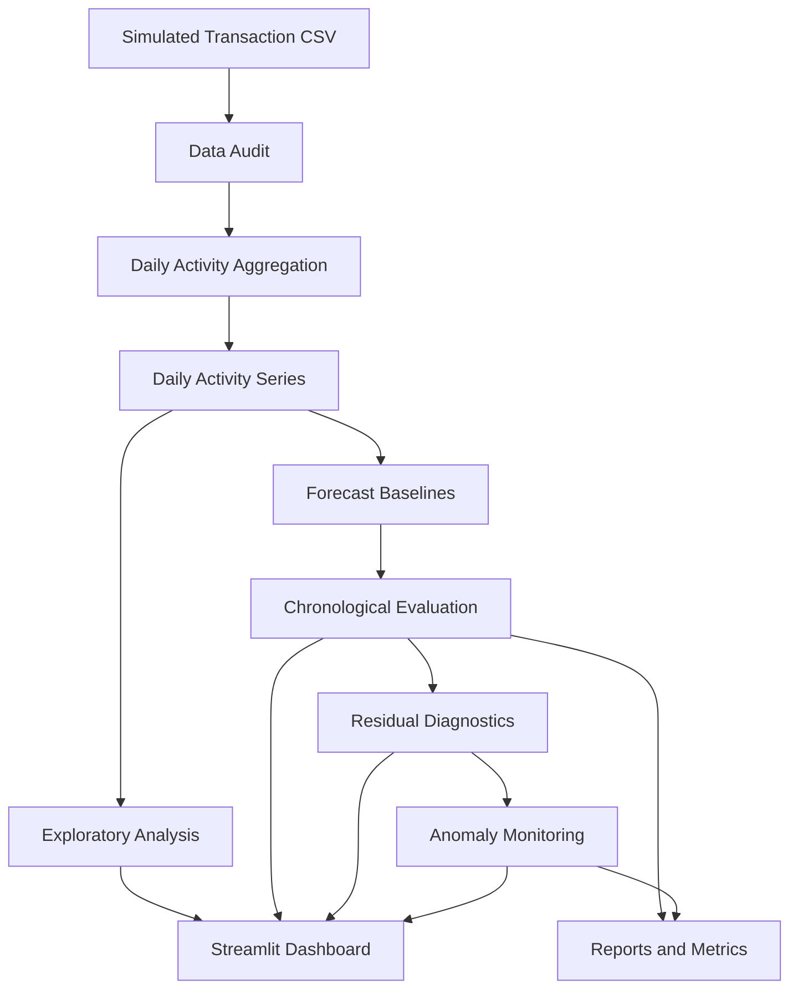

# Financial Activity Forecasting & Risk Monitoring

<p align="center">
  <strong>A reproducible time-series analytics platform for financial transaction-volume forecasting, baseline evaluation, and anomaly monitoring.</strong>
</p>

<p align="center">
  
  
  
  
  
  
</p>


---

## Overview

Financial institutions need to understand transaction activity, anticipate operational workload, and investigate unusual changes in transaction volume.

This project develops an end-to-end analytical workflow using simulated financial transaction data. It audits the source data, builds daily activity series, compares forecasting baselines using chronological evaluation, analyzes forecast errors, and generates monitoring outputs.

The goal is not simply to produce a forecast. It is to create a **reproducible, explainable, and decision-oriented analytics system**.

## Dashboard

[!overview](docs/1.png)
[!risks](docs/2.png)
[!models](docs/3.png)


## Business Problem

A financial operations team may need to answer:

- How many transactions should we expect each day?
- How accurate are simple forecasting approaches?
- When does forecast error increase significantly?
- Which baseline performs best on validation data?
- How can unusual activity be flagged for further investigation?
- What limitations should decision-makers understand before relying on forecasts?

**Important:** A transaction-volume anomaly is not the same as fraudulent activity. This project monitors forecasting behavior; it does not establish that an unusual volume is fraud.

## Project Architecture



### Analytical workflow

1. **Data quality:** inspect missing values, invalid values, transaction types, and step coverage.
2. **Aggregation:** transform hourly simulation steps into daily activity.
3. **Exploration:** investigate changes in daily transaction volume.
4. **Forecasting:** compare previous-day, training-median, and trailing seven-day median baselines.
5. **Evaluation:** measure Mean Absolute Error (MAE) and Root Mean Squared Error (RMSE).
6. **Diagnostics:** examine residuals and compare monitoring thresholds.
7. **Monitoring:** generate forecast-anomaly reports for investigation.
8. **Presentation:** expose results through a Streamlit dashboard.

## Technology Stack

| Technology | Purpose |
|---|---|
| Python | Core implementation |
| Pandas, NumPy | Data processing and numerical analysis |
| Matplotlib | Visualizations |
| Scikit-learn | Forecast evaluation metrics |
| Streamlit | Interactive dashboard |
| Pytest | Automated tests |
| PyArrow | Parquet support for data workflows |

## Dataset

The project uses a PaySim-style simulated transaction dataset.

| Property | Value |
|---|---:|
| Source rows | 6,362,620 |
| Source columns | 11 |
| Unique simulation steps | 743 |
| Complete daily observations used | 30 |
| Final partial day | Excluded from daily evaluation |

Key source fields include transaction type, amount, origin and destination balances, simulation step, and fraud-related labels.

The forecasting target is **daily transaction count**. The simulation step is not a real calendar timestamp.

### Data handling

- Raw data is kept separate from generated outputs.
- Daily aggregation is performed from transaction data.
- The final incomplete daily observation is excluded from evaluation.
- Forecast comparisons preserve chronological ordering.
- No claim is made that simulated activity patterns represent real banking operations.

## Forecasting Methodology

Three simple forecasting baselines are evaluated.

| Baseline | Forecast rule |
|---|---|
| Previous-day | Use the preceding day's observed transaction count |
| Training median | Use the median transaction count from the training period |
| Trailing 7-day median | Use the median of the previous seven available days |

### Evaluation design

| Period | Days | Purpose |
|---|---|---|
| Training | 1–18 | Establish the training reference |
| Validation | 19–24 | Compare candidate baselines |
| Test | 25–30 | Report performance on later observations |

The previous-day and trailing-median methods are evaluated as one-step-ahead forecasts. They use historical observations available before the forecasted day.

**Evaluation caveat:** Test results have already been inspected during exploratory model comparisons. Therefore, the test period should not be described as a completely untouched holdout. A future formal evaluation should reserve a new, untouched chronological period when sufficient data becomes available.

## Results

The following metrics are from the current exploratory run. Lower MAE and RMSE indicate smaller forecast errors.

| Model | Validation MAE | Validation RMSE | Test MAE | Test RMSE |
|---|---:|---:|---:|---:|
| Previous-day | 12,094.00 | 15,064.42 | 27,389.00 | 32,016.06 |
| Training median | 377,440.83 | 377,762.02 | 382,711.50 | 383,285.95 |
| Trailing 7-day median | 196,517.50 | 263,702.86 | 22,977.67 | 23,521.28 |

### Interpretation

- The previous-day baseline achieved the lowest validation MAE.
- The trailing seven-day median performed better on the reported test period, demonstrating that the relative performance of simple methods can change over time.
- The training-median baseline performed poorly on these evaluation periods.
- The previous-day baseline is the current validation-selected candidate, not a proven production-ready forecasting model.

These metrics measure errors in **transaction counts**, not fraud-detection accuracy or monetary losses.

## Forecast Monitoring

The monitoring workflow calculates one-step-ahead forecast residuals:

`Residual = Actual transaction count − Forecast transaction count`

It uses a robust residual-based score to flag potentially unusual forecast errors.

The current exploratory run produced no alerts at the tested robust-score threshold. This means the threshold was not crossed during the monitored period; it does **not** prove that the data contained no anomalies or fraud.

The training history is short, so the stability of the estimated residual thresholds remains uncertain.

## Repository Structure

```text
financial-activity-forecasting/
├── data/
│   ├── raw/
│   │   └── transactions.csv
│   ├── processed/
│   │   └── daily_activity.csv
│   └── reports/
│       ├── data_audit.json
│       ├── daily_activity.png
│       ├── residual_diagnostics.png
│       ├── rolling_baseline_predictions.csv
│       ├── rolling_baseline_metrics.json
│       ├── rolling_model_comparison.csv
│       ├── model_error_analysis.csv
│       ├── forecast_anomaly_alerts.csv
│       └── residual_diagnostics.json
├── src/
│   ├── data/
│   ├── features/
│   ├── models/
│   ├── evaluation/
│   ├── monitoring/
│   ├── visualization/
│   └── dashboard/
│       └── app.py
├── tests/
├── requirements.txt
├── .gitignore
└── README.md
```

Generated report names may vary as the project evolves. The raw dataset should not be committed to a public repository unless its redistribution terms and size make that appropriate.

## Getting Started

### 1. Clone the repository

```bash
git clone https://github.com/Rauof-Qadir/financial-activity-forecasting.git
cd financial-activity-forecasting
```


### 2. Create a virtual environment

Windows PowerShell:

```powershell
python -m venv .venv
.\.venv\Scripts\Activate.ps1
```

### 3. Install dependencies

```powershell
python -m pip install --upgrade pip
pip install -r requirements.txt
```

### 4. Add the dataset

Place the source CSV at:

```text
data/raw/transactions.csv
```

The repository's `.gitignore` should exclude the raw dataset and virtual environment.

### 5. Run the analysis

Run these commands from the project root, in order:

```powershell
python .\src\data\audit_data.py
python .\src\data\build_daily_series.py
python .\src\data\investigate_activity.py
python .\src\features\visualize_daily_activity.py
python .\src\evaluation\compare_baselines.py
python .\src\monitoring\forecast_anomaly_monitor.py
python .\src\evaluation\threshold_sensitivity.py
python .\src\evaluation\residual_diagnostics.py
python .\src\visualization\plot_residual_diagnostics.py
python .\src\evaluation\compare_rolling_models.py
python .\src\evaluation\analyze_model_errors.py
```

Run the automated tests:

```powershell
python -m pytest .\tests -v
```

Launch the dashboard after generating the required outputs:

```powershell
python -m streamlit run .\src\dashboard\app.py
```

## Engineering Practices

The project emphasizes:

- Chronological data splitting rather than random shuffling for time-dependent evaluation.
- Explicit separation of raw data, processed data, source code, and reports.
- Reusable evaluation metrics and saved predictions.
- Automated tests for core evaluation and monitoring behavior.
- Documented assumptions, thresholds, and limitations.
- Reproducible commands for running the analysis.

## Current Limitations

1. **Simulated data:** patterns may not generalize to real financial institutions.
2. **Limited history:** 30 complete daily observations are insufficient to establish stable seasonality or long-term trends.
3. **Irregular activity:** unusually large changes in daily counts may dominate forecast errors.
4. **Exploratory test usage:** the current test results have already been inspected.
5. **Simple baselines:** no advanced forecasting model has yet demonstrated reliable out-of-sample superiority.
6. **Volume monitoring only:** this workflow does not independently determine whether transactions are fraudulent.

## Roadmap

- [ ] Add a reproducible end-to-end pipeline command.
- [ ] Add a CI workflow that runs the test suite on every push.
- [ ] Improve validation with rolling-origin evaluation.
- [ ] Establish longer, more representative time-series data.
- [ ] Add forecast intervals and calibration diagnostics.
- [ ] Add dashboard filters and clearer alert explanations.
- [ ] Add a model card documenting intended use, evaluation, and limitations.
- [ ] Capture and publish verified dashboard screenshots.
- [ ] Re-evaluate candidate models on a new untouched holdout period.

## Author

**Rauof Qadir**
Software Engineer | Aspiring Data Scientist

Interested in Data Science, Financial Analytics, Machine Learning, and building reproducible analytical systems.


---

<p align="center">
  <em>Built as a portfolio project focused on transparent evaluation, reproducibility, and responsible financial analytics.</em>
</p>
